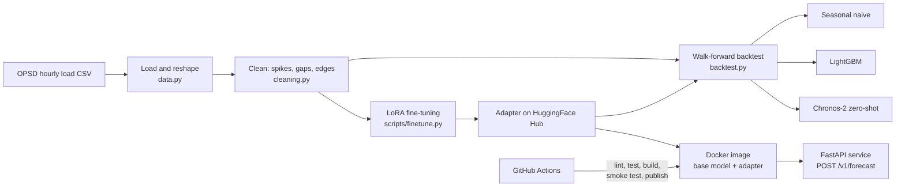

# gridcast

[](https://github.com/HarrisDe/gridcast/actions/workflows/ci.yml)

Day-ahead electricity load forecasting as a production-style ML service.

A pretrained time-series foundation model ([Chronos-2](https://huggingface.co/amazon/chronos-2)) is
fine-tuned with LoRA on European load data, benchmarked against classical baselines with a
leakage-safe backtest, and served through a tested, containerized FastAPI service that is built
and published by CI. Everything, including the fine-tuning, runs on CPU.

| | |
|---|---|
| Fine-tuned adapter | [HarrisDe/chronos2-lora-eu-load](https://huggingface.co/HarrisDe/chronos2-lora-eu-load) on the HuggingFace Hub |
| Container image | `ghcr.io/harrisde/gridcast:latest` |
| Data | [Open Power System Data](https://data.open-power-system-data.org/time_series/2020-10-06/), hourly load from the ENTSO-E Transparency Platform |

## Contents

- [Results](#results)
- [How it works](#how-it-works)
- [Run it: three options](#run-it-three-options)
  - [Option 1: run the published image (fastest)](#option-1-run-the-published-image-fastest)
  - [Option 2: run from source](#option-2-run-from-source)
  - [Option 3: build the image yourself](#option-3-build-the-image-yourself)
- [Using the API](#using-the-api)
- [Reproducing the experiments](#reproducing-the-experiments)
- [Configuration](#configuration)
- [Project layout](#project-layout)
- [Development workflow and CI/CD](#development-workflow-and-cicd)
- [Troubleshooting](#troubleshooting)
- [Limitations and next steps](#limitations-and-next-steps)
- [Licence and attribution](#licence-and-attribution)

## Results

The task: at each midnight (UTC), forecast the next 24 hours of national electricity load for
Germany, Spain, France, Greece and Italy.

Scores are MASE (mean absolute scaled error): the model's mean absolute error divided by the error
of a weekly seasonal-naive forecast on the training data. Below 1 is better than repeating the same
hour of the previous week, and lower is better. MASE is scale-free, so countries of very different
size can be compared and averaged.

**Test year 2019, day-ahead forecasts for all 365 days:**

| Model | DE | ES | FR | GR | IT | Mean |
|---|---|---|---|---|---|---|
| Seasonal naive (same hour last week) | 1.090 | 0.936 | 0.929 | 1.022 | 1.042 | 1.004 |
| LightGBM (global model, lag and calendar features) | 0.634 | 0.445 | 0.425 | 0.522 | 0.457 | 0.497 |
| Chronos-2, zero-shot | 0.519 | 0.391 | 0.312 | 0.384 | 0.404 | 0.402 |
| **Chronos-2 + LoRA adapter (this project)** | **0.501** | **0.381** | **0.295** | **0.369** | **0.391** | **0.387** |

What the numbers say:

- Zero-shot Chronos-2, which never saw this data, beats a LightGBM model trained on four years of
  it by about 19%.
- LoRA fine-tuning adds a further 3.7% over zero-shot, consistently in all five countries.
- The largest single gain came from a setting, not from training: giving the model 8 weeks of
  history instead of 2 improved zero-shot accuracy by about 12%.

A fairness note: the LightGBM baseline is deliberately simple. It has no weather inputs, no holiday
features and untuned hyperparameters. A production-grade gradient-boosting model with temperature
forecasts would be considerably stronger.

### How the model was selected

The data is split by time. Settings are chosen on the validation year only, and the test year is
used once, for the final table above.

| Period | Role |
|---|---|
| 2015 to 2017 | Training (fine-tuning) |
| 2018 | Validation (choosing context length and fine-tuning settings) |
| 2019 | Test (reported once) |
| 2020 | Held back (contains the COVID demand shock, reserved for drift monitoring) |

**Context length, zero-shot, validation year 2018:**

| History given to the model | Mean MASE | Backtest time on CPU |
|---|---|---|
| 168 h (1 week) | 0.540 | 4.8 min |
| 336 h (2 weeks) | 0.448 | 5.3 min |
| 672 h (4 weeks) | 0.413 | 7.5 min |
| **1,344 h (8 weeks), selected** | **0.396** | 9.9 min |
| 2,016 h (12 weeks) | 0.395 | 12.7 min |

**Fine-tuning, validation year 2018:**

| Model | Mean MASE |
|---|---|
| Zero-shot | 0.396 |
| LoRA, 500 steps, learning rate 1e-5 | 0.392 |
| **LoRA, 500 steps, learning rate 1e-4, selected** | **0.385** |

The ranking of the three models on the test year matches their ranking on validation.

## How it works



**Data.** Hourly actual load per country, 2015 to 2020, converted to a long table with the columns
`item_id`, `timestamp` (UTC) and `target` (MW).

**Cleaning.** Isolated spikes are detected by comparing each value with a centred 25-hour rolling
median and are treated as missing (the raw data contains, for example, a single 158,000 MW hour for
France). Missing values at the edges are trimmed, gaps of up to 6 hours are interpolated, and longer
gaps are left missing rather than invented.

**Evaluation.** A walk-forward backtest: for every day of the evaluation period, the model receives
only the data before that day's midnight and forecasts the next 24 hours. All models go through the
same loop behind one `Forecaster` interface.

**Models.**

- *Seasonal naive* repeats the same hours from one week earlier.
- *LightGBM* is one global model for all countries. Its features are calendar fields and lags of at
  least 24 hours, so all 24 hours are predicted directly with no recursion. Load values are divided
  by each series' mean over the last week, which lets one model serve systems of very different
  size. The same feature function is used for training and prediction.
- *Chronos-2* is a 120-million-parameter pretrained Transformer, used zero-shot and then fine-tuned
  with LoRA. LoRA freezes the original weights and trains small added matrices, about 1.2 million
  parameters (1% of the model), saved as a 5 MB adapter.

**Serving.** A FastAPI service loads the model once at startup and returns probabilistic forecasts
(quantiles). The Docker image contains the base model and the adapter, so the service starts with
no downloads and no network access.

## Run it: three options

| Option | You need | Time to first forecast | Use it when |
|---|---|---|---|
| 1. Published image | Docker | A few minutes (one 860 MB download) | You want to try the service |
| 2. From source | Python 3.11+ | 10 to 15 minutes | You want to run the tests, experiments or change code |
| 3. Build the image | Docker | 5 to 10 minutes | You changed the code and want your own image |

### Option 1: run the published image (fastest)

**Step 1. Install and start Docker.**
Install [Docker Desktop](https://www.docker.com/products/docker-desktop/) (Windows, macOS) or Docker
Engine (Linux), and make sure it is running. Check with:

```bash
docker version
```

The output must contain a `Server` section. If it shows only `Client`, the Docker engine is not
running: start Docker Desktop and wait until it reports that the engine is running.

**Step 2. Start the service.**

```bash
docker run --rm -p 8000:8000 ghcr.io/harrisde/gridcast:latest
```

The first run downloads the image (about 860 MB compressed, 2.9 GB on disk). The service is ready
when you see:

```
INFO:     Application startup complete.
INFO:     Uvicorn running on http://0.0.0.0:8000 (Press CTRL+C to quit)
```

`-p 8000:8000` makes the service reachable on port 8000 of your machine. `--rm` removes the
container when it stops.

**Step 3. Check that it is alive.** Open <http://127.0.0.1:8000/health> in a browser, or run:

```bash
curl http://127.0.0.1:8000/health
```

Expected response:

```json
{"status": "ok", "version": "0.1.0"}
```

**Step 4. Request a forecast.** Open a second terminal and send two weeks of hourly values. These
examples use an artificial daily wave, so you need no dataset.

Linux or macOS:

```bash
curl -s -X POST http://127.0.0.1:8000/v1/forecast \
  -H "Content-Type: application/json" \
  -d "{\"history\": $(python3 -c 'import math; print([1000 + 300 * math.sin(2 * math.pi * h / 24) for h in range(336)])'), \"horizon\": 24}"
```

Windows PowerShell:

```powershell
$history = 0..335 | ForEach-Object { 1000 + 300 * [math]::Sin(2 * [math]::PI * $_ / 24) }
$body = @{ history = $history; horizon = 24 } | ConvertTo-Json -Compress
Invoke-RestMethod -Uri http://127.0.0.1:8000/v1/forecast -Method Post -ContentType "application/json" -Body $body
```

The response contains the model name, the horizon, and three lists of 24 hourly values: the 10th
percentile, the median and the 90th percentile.

**Step 5. Explore the interactive documentation** at <http://127.0.0.1:8000/docs>. It lists the
endpoints and their request and response formats, and lets you call them from the page.

**Step 6. Stop the service** with `Ctrl+C` in the first terminal.

### Option 2: run from source

**Step 1. Check the prerequisites.**

```bash
git --version
python --version      # 3.11 or newer; on some systems the command is python3
```

You also need about 4 GB of free disk space (PyTorch, the model weights and the dataset).

**Step 2. Clone the repository.**

```bash
git clone https://github.com/HarrisDe/gridcast.git
cd gridcast
```

**Step 3. Create and activate a virtual environment.**

Linux or macOS:

```bash
python -m venv .venv
source .venv/bin/activate
```

Windows PowerShell:

```powershell
python -m venv .venv
.venv\Scripts\Activate.ps1
```

Your prompt should now start with `(.venv)`. If PowerShell refuses to run the activation script,
run `Set-ExecutionPolicy -Scope Process -ExecutionPolicy Bypass` and try again. That only affects
the current terminal window.

**Step 4. Install the project.**

On Linux, install the CPU-only build of PyTorch first. Otherwise pip installs the default build,
which bundles several GB of GPU libraries:

```bash
pip install torch --index-url https://download.pytorch.org/whl/cpu
```

On Windows and macOS the default PyTorch build is already CPU-only, so skip that line.

Then, on every platform:

```bash
python -m pip install --upgrade pip
pip install -e ".[dev,ml,chronos,api]"
```

The dependencies are split into groups, so you can install only what you need:

| Group | Contains | Needed for |
|---|---|---|
| `dev` | pytest, Ruff, pre-commit, httpx | Tests and linting |
| `ml` | pandas, NumPy, LightGBM, scikit-learn | Data pipeline, LightGBM, backtesting |
| `chronos` | PyTorch, chronos-forecasting, PEFT | Chronos-2 inference and fine-tuning |
| `api` | FastAPI, Uvicorn | The HTTP service |

**Step 5. Run the tests.**

```bash
pytest
```

Expected: `24 passed`. The tests use small synthetic data and fake models, so they need neither the
dataset nor the model weights, and finish in a few seconds. Without the `chronos` group installed,
one test is skipped.

**Step 6. Get the data.** The dataset is downloaded automatically the first time a script needs it,
to `data/raw/opsd_time_series_60min.csv` (a CSV of more than 100 MB). To fetch it explicitly:

```bash
python -c "from gridcast.data import download_raw; print(download_raw())"
```

If the download fails, for example behind a company proxy, download
[this file](https://data.open-power-system-data.org/time_series/2020-10-06/time_series_60min_singleindex.csv)
in a browser and save it under exactly that path and name. The scripts will find it and skip the
download.

**Step 7. Start the API.** To serve the fine-tuned model, set `GRIDCAST_MODEL_ID` to the adapter's
name on the HuggingFace Hub. Without it, the service uses the base model `amazon/chronos-2`.

Linux or macOS:

```bash
export GRIDCAST_MODEL_ID=HarrisDe/chronos2-lora-eu-load
uvicorn gridcast.api:app
```

Windows PowerShell:

```powershell
$env:GRIDCAST_MODEL_ID = "HarrisDe/chronos2-lora-eu-load"
uvicorn gridcast.api:app
```

On the first start, the base model (about 480 MB) and the adapter (5 MB) are downloaded from the
HuggingFace Hub into your user cache. A warning about unauthenticated requests is harmless: both
repositories are public and need no account. Wait for `Application startup complete`.

**Step 8. Call it with real data.** In a second terminal, with the virtual environment activated:

```bash
python scripts/call_api.py
```

The script sends eight weeks of Greek load ending on 30 June 2019 and compares the forecast for
1 July with what actually happened:

```
Status 200, model: HarrisDe/chronos2-lora-eu-load
Round trip: 0.36 s
hour  actual     p10     p50     p90
   0    4826    4860    4920    4999
   4    5524    5454    5599    5743
   8    7354    6976    7313    7670
  12    7377    6882    7302    7784
  16    7079    6628    6940    7240
  20    6561    6189    6434    6692
MAE of the median: 110 MW
```

Stop the server with `Ctrl+C`.

### Option 3: build the image yourself

With Docker running, from the repository root:

```bash
docker compose up --build
```

This builds the image from the `Dockerfile` and starts the service on port 8000 with a health check.
The first build takes several minutes, since it installs PyTorch and downloads both the base model
and the adapter into the image. Later builds reuse cached layers and take seconds, unless
dependencies change.

In a second terminal:

```bash
docker compose ps       # STATUS shows (healthy) after about 30 seconds
```

Then call the service as in Option 1 or with `python scripts/call_api.py`. Stop it with `Ctrl+C`,
followed by:

```bash
docker compose down
```

To build an image with a different adapter from the HuggingFace Hub:

```bash
docker build --build-arg ADAPTER_REPO=your-name/your-adapter -t gridcast-api .
```

## Using the API

### `GET /health`

Returns `{"status": "ok", "version": "..."}` when the service is running. Used by Docker's health
check and by the CI smoke test.

### `POST /v1/forecast`

**Request body:**

| Field | Type | Required | Rules | Meaning |
|---|---|---|---|---|
| `history` | list of numbers or `null` | Yes | At least 168 values | Hourly values, oldest first. Use `null` for missing hours. |
| `horizon` | integer | No, default 24 | 1 to 168 | Number of hours to forecast |
| `quantile_levels` | list of numbers | No, default `[0.1, 0.5, 0.9]` | Each between 0.01 and 0.99 | Quantiles to return |

The service uses the most recent 1,344 values (8 weeks) of `history`. Sending fewer works, with
lower accuracy. The values can be on any scale, and no timestamps are needed.

**Example request:**

```json
{
  "history": [5123.0, 5010.5, null, 4890.2, "... at least 168 values ..."],
  "horizon": 24,
  "quantile_levels": [0.1, 0.5, 0.9]
}
```

**Example response (shortened):**

```json
{
  "model": "HarrisDe/chronos2-lora-eu-load",
  "horizon": 24,
  "quantiles": {
    "0.1": [4860.1, 4702.3, "... 24 values ..."],
    "0.5": [4920.4, 4768.9, "... 24 values ..."],
    "0.9": [4999.0, 4841.2, "... 24 values ..."]
  }
}
```

The `0.5` list is the median, to be used as the point forecast. The range between `0.1` and `0.9`
is an 80% prediction interval.

**Status codes:**

| Code | Meaning |
|---|---|
| `200` | Forecast returned |
| `422` | The request failed validation, for example fewer than 168 values or a quantile level outside the allowed range. The response body explains which field is wrong. |

**Calling it from Python:**

```python
import httpx

history = [...]  # your hourly values, oldest first, at least 168 of them
response = httpx.post(
    "http://127.0.0.1:8000/v1/forecast",
    json={"history": history, "horizon": 24},
    timeout=60,
)
response.raise_for_status()
median = response.json()["quantiles"]["0.5"]
```

The first request after startup is slower than later ones (about 0.9 s against 0.4 s on a laptop
CPU), because PyTorch performs one-off initialization on its first forecast.

## Reproducing the experiments

All commands are run from the repository root with the virtual environment activated and all four
dependency groups installed (Option 2, steps 1 to 6). Times are for a laptop CPU.

**Compare all models on the 2019 test year** (about 25 minutes):

```bash
python scripts/evaluate.py
```

It trains the LightGBM model on 2015 to 2018, loads the base model and the adapter from the
HuggingFace Hub, and prints a MAE and MASE table per country for each of the four models. The
output should match the results table at the top of this page.

**Repeat the context-length study on the 2018 validation year** (about 40 minutes):

```bash
python scripts/tune_context.py
```

**Score one model on the validation year** (about 10 minutes):

```bash
python scripts/validate.py                                            # base model
python scripts/validate.py --model-id HarrisDe/chronos2-lora-eu-load  # the adapter
```

The script prints which model it loaded before the scores.

**Fine-tune your own adapter.** A 10-step trial first, to check that training runs and to measure
the time per step (about 1 minute):

```bash
python scripts/finetune.py
```

Then the configuration used for the published adapter (about 57 minutes, at roughly 7 seconds per
step):

```bash
python scripts/finetune.py --num-steps 500 --learning-rate 1e-4 --name my-adapter
```

Fine-tuning uses 2015 to 2017 only. The adapter is saved to `artifacts/my-adapter/finetuned-ckpt/`
as `adapter_model.safetensors` (about 5 MB) and `adapter_config.json`. To use it:

```bash
python scripts/validate.py --model-id artifacts/my-adapter/finetuned-ckpt
```

To serve it, set `GRIDCAST_MODEL_ID` to that path before starting the API. To publish it, log in
with `hf auth login` and run
`hf upload your-name/your-adapter artifacts/my-adapter/finetuned-ckpt .`

| Script argument | Default | Meaning |
|---|---|---|
| `--num-steps` | 10 | Number of weight updates |
| `--batch-size` | 8 | Training windows per update |
| `--learning-rate` | 1e-5 | Step size of each update |
| `--name` | `chronos2-lora-trial` | Output folder under `artifacts/` |

## Configuration

Settings are defined in `src/gridcast/config.py`. Each one can be overridden with an environment
variable, or with a line in a local `.env` file, without changing code. The same image can therefore
serve different models in different environments.

| Variable | Default | Meaning |
|---|---|---|
| `GRIDCAST_MODEL_ID` | `amazon/chronos-2` (the published image sets the adapter) | HuggingFace Hub name or local folder of the model to serve |
| `GRIDCAST_DEVICE` | `cpu` | `cpu` or `cuda` |
| `GRIDCAST_CONTEXT_LENGTH` | `1344` | Hours of history given to the model |
| `GRIDCAST_PREDICTION_LENGTH` | `24` | Forecast length used in fine-tuning |
| `GRIDCAST_DATA_DIR` | `data` | Where the dataset is stored |
| `GRIDCAST_ARTIFACTS_DIR` | `artifacts` | Where fine-tuned adapters are saved |
| `HF_HUB_OFFLINE` | unset (the image sets `1`) | Set to `1` to load models from the local cache only, with no network calls |

Because these variables are read silently, a value left over in a terminal changes which model is
loaded. `scripts/evaluate.py` therefore names its models explicitly, and `scripts/validate.py`
prints the model it loaded.

## Project layout

```
gridcast/
├── src/gridcast/
│   ├── config.py          Typed settings, overridable through GRIDCAST_* variables
│   ├── data.py            Download the OPSD file, reshape to a long table
│   ├── cleaning.py        Spike removal, edge trimming, short-gap interpolation
│   ├── features.py        Scale-free features, shared by training and prediction
│   ├── metrics.py         MAE and MASE
│   ├── forecasters.py     Forecaster interface and the seasonal-naive baseline
│   ├── lgbm.py            Global LightGBM forecaster
│   ├── chronos_model.py   Chronos-2 wrapper (base model or LoRA adapter)
│   ├── backtest.py        Walk-forward evaluation
│   ├── schemas.py         API request and response models
│   └── api.py             FastAPI application
├── scripts/
│   ├── evaluate.py        Compare all models on the test year
│   ├── tune_context.py    Context-length study on the validation year
│   ├── finetune.py        LoRA fine-tuning
│   ├── validate.py        Score one Chronos-2 model on the validation year
│   └── call_api.py        Example client using real data
├── tests/                 pytest suite (synthetic data and fake models)
├── Dockerfile             CPU-only image with base model and adapter baked in
├── compose.yaml           Run the service with a health check
├── .github/workflows/     CI/CD pipeline
└── pyproject.toml         Packaging, dependency groups, tool settings
```

## Development workflow and CI/CD

**Local checks.** After installing the `dev` group:

```bash
pre-commit install          # once per clone: run the checks on every commit
ruff check --fix .          # lint
ruff format .               # format
pytest                      # tests with coverage
```

**Pipeline.** `.github/workflows/ci.yml` runs on every push to `main` and on every pull request:

1. **Test job.** Installs the project on a clean Linux machine, runs `ruff check`,
   `ruff format --check` and `pytest`. It installs the `dev`, `ml` and `api` groups only, so it
   finishes in under a minute.
2. **Docker job**, on pushes to `main`, only if the test job passed:
   - builds the image, reusing cached layers,
   - starts a container and smoke-tests it: waits for `/health`, then sends a real forecast request,
   - publishes the image to GitHub Container Registry, tagged with the commit ID and `latest`.

An image is published only if linting, tests and the smoke test all pass, and every image can be
traced to the commit that produced it.

**Image design.** The Dockerfile orders its layers from least to most frequently changed (PyTorch,
other dependencies, model weights, application code), so a code change rebuilds only the last
layer. The container runs as an unprivileged user and with `HF_HUB_OFFLINE=1`, so it makes no
network calls at startup.

## Troubleshooting

| Symptom | Cause and fix |
|---|---|
| `failed to connect to the docker API` or `error waiting for container: unexpected EOF` | The Docker engine is not running, or stopped while the container ran. Start Docker Desktop, wait for the engine, and run the command again. |
| `port is already allocated` or `address already in use` | Something else is using port 8000, often an earlier container. Find it with `docker ps` and stop it with `docker stop <id>`, or use another port: `-p 8001:8000`. |
| `error getting credentials ... docker-credential-desktop` | The terminal was opened before Docker Desktop was installed. Close and reopen the terminal (or the editor). |
| `getaddrinfo failed` or `URLError` when downloading the data | The network blocks the download. Fetch the file in a browser and save it as `data/raw/opsd_time_series_60min.csv` (Option 2, step 6). |
| `Warning: You are sending unauthenticated requests to the HF Hub` | Harmless. The models are public. |
| `scikit-learn is required for lightgbm.sklearn` | The `ml` group is not installed. Run `pip install -e ".[dev,ml]"`. |
| A script loads a different model than expected | A `GRIDCAST_MODEL_ID` variable is set in the terminal. Remove it: `unset GRIDCAST_MODEL_ID` (Linux, macOS) or `Remove-Item Env:GRIDCAST_MODEL_ID` (PowerShell). |
| A model fails to load with a "not found" error after setting `HF_HUB_OFFLINE=1` | The model is not in the local cache yet. Unset the variable for the first run so it can be downloaded. |
| `Activate.ps1 cannot be loaded because running scripts is disabled` | Run `Set-ExecutionPolicy -Scope Process -ExecutionPolicy Bypass` in that terminal, then activate again. |

## Limitations and next steps

- **Baseline strength.** LightGBM has no weather or holiday features and default hyperparameters.
  Temperature is the main driver of load, so adding weather forecasts is the obvious improvement
  for every model.
- **Holidays.** No model here knows the calendar of public holidays, and errors on those days are
  several times larger than on ordinary days.
- **Fine-tuning budget.** Training was limited to 500 steps with a batch size of 8 on a CPU. The
  gain is modest (3.7%), as expected for smooth, aggregated series that resemble the model's
  pretraining data. Larger gains are more likely on noisy, unusual series such as individual
  sensors or buildings.
- **Adapter versioning.** The image downloads the adapter's latest revision at build time. Pinning
  an exact revision would tie each image to one adapter version.
- **Planned:** asynchronous batch jobs with a queue and a separate worker, monitoring with drift
  detection on the held-back 2020 period, and Kubernetes manifests.

## Licence and attribution

- Code: MIT (see `LICENSE`).
- Data: Open Power System Data, time series package version 2020-10-06, based on the ENTSO-E
  Transparency Platform.
- Base model: [amazon/chronos-2](https://huggingface.co/amazon/chronos-2), Apache 2.0. The adapter
  is published under the same licence.
